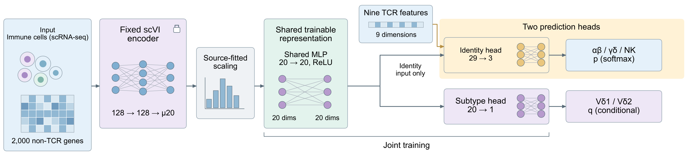
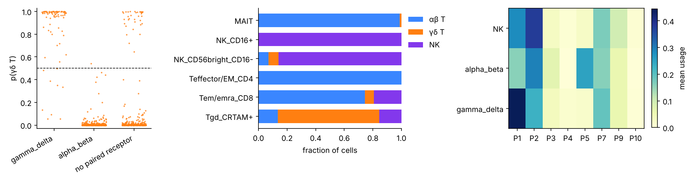

==========================================================================================
gdTProfiler: multi-level prediction and cell-state profiling of human γδ T cells
==========================================================================================

About
=====

gdTProfiler identifies human γδ T cells in single-cell RNA-seq data, predicts
their Vδ1/Vδ2 receptor subtype, and describes their transcriptional state with a
fixed reference of eight expression programmes. It works on raw counts and does
not require T-cell receptor (TCR) sequencing.

* **Identity.** A joint classifier assigns each cell a probability of being an
  αβ T cell, a γδ T cell or an NK cell. It combines a fixed scVI representation of
  2,000 non-TCR genes with nine TCR transcripts (TRAC, TRBC1/2, TRDC, TRGC1/2,
  TRDV1/2/3). It was trained on receptor-supported labels and reached average
  precision ≥ 0.99 in donor-held-out and external testing.
* **Subtype.** A second head predicts Vδ1 versus Vδ2 from non-TCR expression.
* **Cell state.** Cells are projected onto eight cNMF programmes (P1, P2, P3,
  P4, P5, P7, P9, P10) learned from adult human γδ T cells, with a
  reconstruction error that flags cells the reference does not describe well.

The identity head relies on *TRDV* and *TRGC* transcripts. It tolerates loss of
*TRDC* detection, but it should not be applied to assays that do not measure
*TRDV1–3*, such as some targeted spatial panels, without separate validation.

Installation
============

Install the latest version from GitHub::

    pip install -U git+https://github.com/KaelynWenHKU/gdTProfiler

gdTProfiler needs only NumPy, pandas, SciPy, scikit-learn and anndata. The
trained model is included in the package, so no download or GPU is needed.
Installation takes less than a minute.

Quick example
=============

Using the built-in spleen dataset (1,060 cells from the Cross-tissue Immune Cell
Atlas, with receptor-defined labels), the following script predicts identity and
subtype, scores the eight programmes and plots the results:

.. code-block:: python

    import gdtprofiler as gdt
    import gdtprofiler.plotting as pl

    adata = gdt.datasets.spleen_example()   # raw counts; use ad.read_h5ad() for your data
    gdt.predict(adata)                      # identity (αβ T / γδ T / NK) and Vδ1/Vδ2 subtype
    gdt.score_programmes(adata)             # usage of the eight γδ T-cell programmes

    # visualize
    pl.identity_scores(adata, groupby="receptor_identity")
    pl.class_composition(adata, groupby="author_annotation")
    pl.programme_usage(adata, groupby="gdT_class")

Results are added to ``adata.obs``:

=========================  =====================================================
Column                     Meaning
=========================  =====================================================
``gdT_p_alpha_beta``       Probability of αβ T cell
``gdT_p_gamma_delta``      Probability of γδ T cell
``gdT_p_NK``               Probability of NK cell
``gdT_class``              Most probable class
``gdT_call``               ``gdT_p_gamma_delta`` ≥ 0.5 (threshold used in the paper)
``gdT_q_Vdelta1``          Vδ1 score (1 − score = Vδ2); interpret only for γδ T cells
``gdT_P1`` … ``gdT_P10``   Relative usage of each programme (rows sum to 1)
``gdT_relative_error``     Reconstruction error of the programme fit
``gdT_within_q95``         Error within the 95th percentile of the reference
=========================  =====================================================

For your own data, raw counts may sit in a layer: ``gdt.predict(adata, layer="counts")``.

Detailed Manual
===============

* `Tutorial: identifying γδ T cells and scoring their programmes in spleen data <tutorial/gdTProfiler_tutorial.ipynb>`_
* `Documentation <docs/>`_ (installation, input requirements, outputs and API)

License
=======

gdTProfiler is released under the `Apache License 2.0 <LICENSE>`_.

References
==========

Wen, K. N., Huang, Y. & Park, S. H. Multi-level prediction and landscape
characterization of human γδ T cells across single-cell and spatial
transcriptomic atlases. *bioRxiv* (2026).
